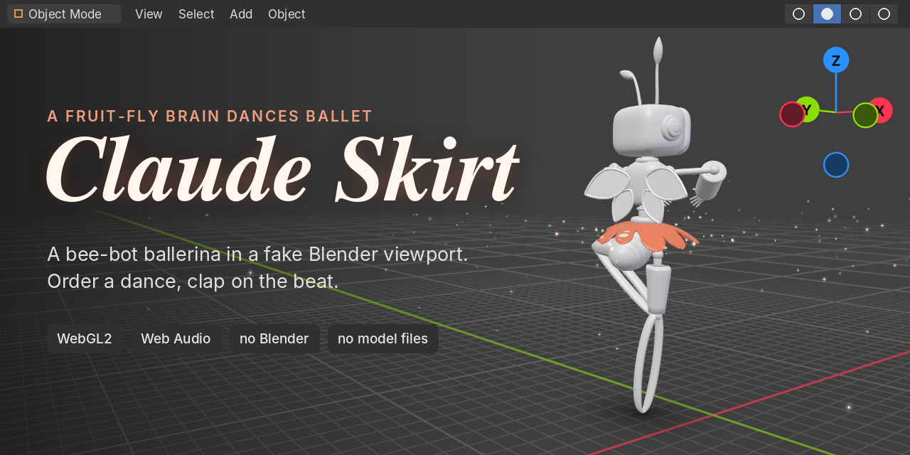
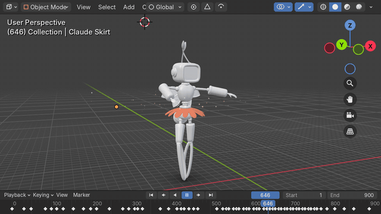
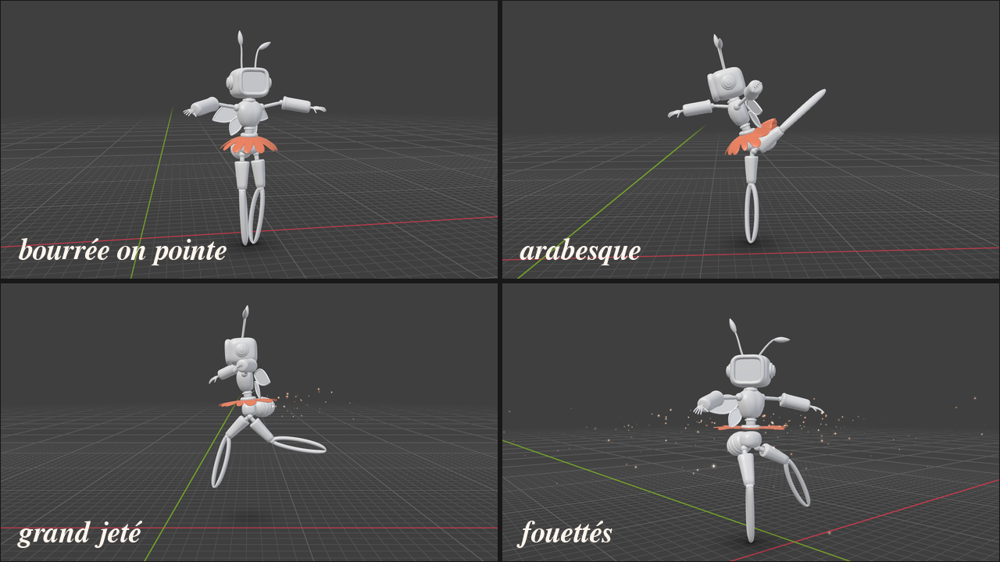
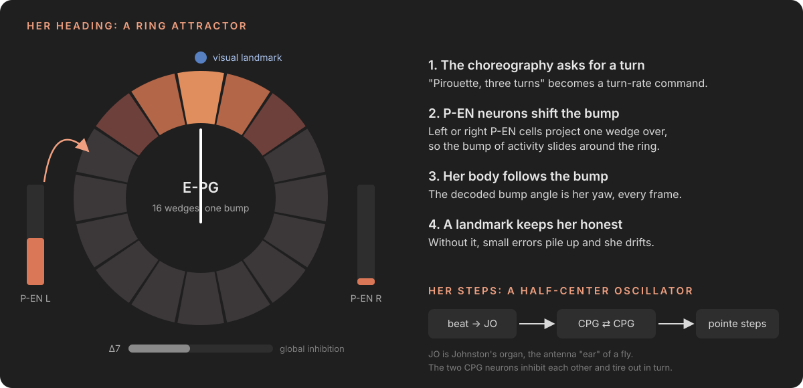

<p align="center">
  
</p>

<p align="center">
  <a href="https://mywestlord.github.io/claude-skirt/"><b>▶ Play in your browser</b></a>
  &nbsp;·&nbsp;
  <a href="https://mywestlord.github.io/claude-skirt/dist/claude-skirt.html">Single-file version</a>
  &nbsp;·&nbsp;
  <a href="assets/trailer.mp4">30-second trailer</a>
</p>

A robot bee ballerina dances inside what looks like Blender's 3D viewport. It is not Blender. The grid, the navigation gizmo, the timeline, the dancer and her **"Claude Skirt"** are all generated when the page loads, by a little under 2,000 lines of JavaScript and HTML. Her spins are steered by a small simulated fruit-fly brain.

There are no model files, no textures and no audio samples in this repository. Everything is math.

<p align="center"></p>

## How to play

- **Order a dance** from the sidebar, or press <kbd>1</kbd> to <kbd>5</kbd>. Order several and they queue up like requests at a jukebox.
- **Clap on the beat** with <kbd>Space</kbd> or the round **CLAP** button. The orange ticks in the timeline are the beats. Hit them to build a combo and fill the Bravo meter; when it fills, she shows off.
- **Move the camera** like in Blender: drag to orbit, scroll or pinch to zoom, click an axis on the gizmo to snap the view, double-click to give the camera back to the auto director.
- **Open the Fly Brain tab** to watch her heading neurons fire while she turns. Switch off the visual landmark and watch her lose her bearings.

## The programme

| | Dance | Music | What she does |
|---|---|---|---|
| I | **Bee Waltz** | E minor music box, 120 BPM, 3/4 | The routine from the trailer. Starts in the exact T-pose of the original Blender screenshot and ends with eight fouettés. |
| II | **Swan Bourrée** | B minor oboe and harp, 84 BPM, 3/4 | Tiny steps on pointe across the stage with rippling swan arms, an arabesque, a slow pirouette and a bow. |
| III | **Fouetté Storm** | A minor galop, 150 BPM, 2/4 | Pirouette, chaînés, a tour en l'air, a manège of piqué turns and sixteen fouettés. |
| IV | **Waggle Dance** | D major with a buzzing kazoo lead, 112 BPM, 4/4 | The honeybee figure-eight that tells the hive where the flowers are, with her bee bottom waggling on every run. Plus two grand jetés. |
| V | **Fly Brain Freestyle** | F minor techno, 124 BPM, 4/4 | Improvised: a different set of moves each time. Includes the fruit-fly courtship song, where she extends one wing and vibrates it. |

<p align="center"></p>

## Her brain is a fruit fly's compass

<p align="center"></p>

Fruit flies keep track of which way they are facing with a ring of neurons in the central complex. Activity forms a single "bump" on the ring, and the bump moves when the fly turns. The dancer uses a small model of that circuit:

- **E-PG ring (16 units).** Neighbours excite each other and everyone inhibits everyone (the Δ7 role), so exactly one bump survives.
- **P-EN drive.** A turn command from the choreography pushes the bump left or right around the ring. The bump angle is decoded every frame and **becomes her body's yaw**. The gain is calibrated so a commanded 28 rad/s turn moves the bump at 28 rad/s (`tools/brain-calibrate.mjs`).
- **Visual landmark.** A weak input pins the bump to where she should be facing, like a fly using the sun. Turn it off in the Fly Brain tab and integration errors build up during long spin sequences.
- **Half-center oscillator.** Two neurons that inhibit each other and tire out in turn (a Matsuoka oscillator) produce the alternating pointe steps of the bourrée. Each musical beat reaches it through the antennae, standing in for Johnston's organ, the fly's hearing organ, and keeps the steps on the beat.

This is a compact computational model inspired by the published circuit. It is not a simulation of the real connectome. The papers it leans on:

- Seelig & Jayaraman, *Neural dynamics for landmark orientation and angular path integration*, Nature 2015.
- Kim, Rouault, Druckmann & Jayaraman, *Ring attractor dynamics in the Drosophila central brain*, Science 2017.
- Green et al., *A neural circuit architecture for angular integration in Drosophila*, Nature 2017.

## How it is built

**The character** was rebuilt in code from a single screenshot of the original Blender model. Her parts are lathes, sweeps along curves, superellipsoids and lofts: a rounded TV-box head with a recessed screen and ear discs, spring-loaded antennae with leaf tips, two pairs of wings, a segmented bee bottom, cuffed forearms, and long looped legs that end in a point, so she is always en pointe. 47 parts plus the skirt, about 50,000 vertices, generated in roughly 60 ms on a desktop.

**The Claude Skirt** is the outline of the Claude spark sampled at 600 angles, widened slightly, and swept outward and down into a tutu. Each frame the petals check eight capsules around her thighs, shins, forearms and hands. Any petal that would cut through a limb is rotated up just enough to clear it, and its neighbours follow, so arms and legs push the skirt aside instead of clipping through it. The skirt also flares with spin speed, trails behind the turn, flutters, and droops when she jumps.

**The animation** is authored in Python (`tools/author.py`) as keyframes on a beat grid: bourrée, pirouette, arabesque, grand jeté, chaînés, manège, fouettés, tour en l'air, waggle run, courtship song, révérence. With `--check` it also plays every dance and reports any frame where an arm passes through the body, the head or a leg. In the browser the keys are interpolated with cardinal splines, arms and legs are solved with two-bone IK, and the head spots during turns: it holds on the camera, then whips around, the way dancers keep from getting dizzy. Antennae hang on damped springs.

**The renderer** is raw WebGL2 with no library, imitating Blender's Solid shading: studio lighting on grey clay, the floor grid with the red X and green Y axes, the 3D cursor and an object origin. Sparkles are additive point sprites flung off the petal tips.

**The music** is synthesized live with Web Audio: a celesta from stacked decaying sine partials, plucked strings, an oboe with delayed vibrato, a kazoo-like buzz with 31 Hz tremolo, pads, brass, kick, snare and hats from oscillators and noise, a generated reverb impulse, and the fly's pulse song as short 250 Hz bursts about 35 ms apart. Applause at the end of a dance is louder the more beats you hit.

## Project layout

```
index.html               GitHub Pages entry (ES modules)
app.html                 the page markup and styles
src/
  main.js                app: dance queue, rhythm game, camera, UI
  geo.js                 procedural character + the Claude Skirt
  rig.js                 skeleton, two-bone IK, forward kinematics
  anim.js                key interpolation, secondary motion, skirt collision, sparkles
  brain.js               ring attractor (E-PG / P-EN / Δ7) + half-center oscillator
  audio.js               Web Audio instruments and scheduler
  render.js              WebGL2 renderer
  dances.data.js         generated choreographies and scores
dist/claude-skirt.html   everything in one file, works offline
tools/
  author.py              writes the dances and the music, checks for clipping
  timeline.py            Python reference of the animation evaluator
  smoke-test.mjs         plays every dance headlessly in Node
  brain-calibrate.mjs    measures the ring attractor's turn gain
  bundle.mjs             builds index.html and the single-file version
  offline/               the Python + OpenGL renderer used for the trailer and these images
```

## Run it locally

Any static file server works, for example:

```sh
python3 -m http.server 8000
# then open http://localhost:8000
```

Or open `dist/claude-skirt.html` directly. After editing the choreography, regenerate and rebuild:

```sh
cd tools && python3 author.py --check && cd ..
node tools/smoke-test.mjs
node tools/bundle.mjs
```

## Credits

Made with Claude. The dancer is a recreation of an original character modeled in Blender.

This is a fan project. It is not affiliated with or endorsed by Anthropic or the Blender Foundation. Code is released under the MIT license.
